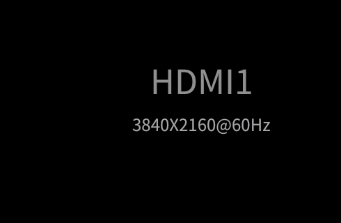
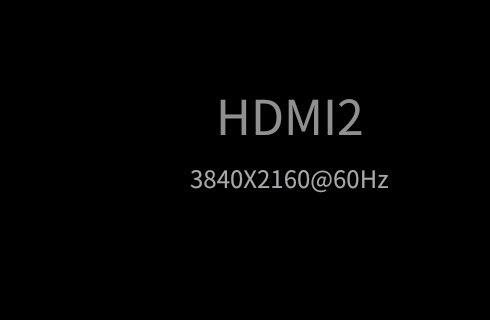

# TCL 55G60E：让 Windows 通过 HDMI 输出 4K 60Hz

在一台使用自如／灵初智能定制系统的 TCL 55G60E 上，HDMI 1 和 HDMI 2 都实际收到了 **3840×2160、60Hz、YCbCr 4:2:0、8 位**。解决方法是在 Windows 用 CRU 补充电视上报的显示能力，再让 NVIDIA 驱动自动选择色彩格式。整个设置在电脑端完成。

| 实测项目 | HDMI 1 | HDMI 2 |
| --- | --- | --- |
| 电视端口的原始 HDMI 物理地址 | 1.0.0.0 | 2.0.0.0 |
| 原始 EDID 列出的 3840×2160 最高刷新率 | 30Hz | 30Hz |
| 电视信号栏读数 | 3840×2160@60Hz | 3840×2160@60Hz |

实测环境为 Windows 11、GeForce RTX 5070 Ti Laptop GPU、笔记本 HDMI 直连，电视显示器 ID 为 `TCL0963`，电视配置版本为 `tcl-G62E-20240521-V001`。以下两张图均截自电视自身的信号信息栏。




## 准备和备份

准备 Windows 64 位 Python 3 和 NVIDIA 显卡驱动。脚本仅使用 Python 标准库。将线接到要测试的电视 HDMI 口，切到该信源，并让 Windows 识别这台电视。在仓库根目录打开 PowerShell，运行以下命令。示例从 HDMI 1 开始。

```powershell
New-Item -ItemType Directory -Force local | Out-Null
python nvidia_tv.py backup local/hdmi1-original.bin --port 1
python edid.py inspect local/hdmi1-original.bin
python edid.py build local/hdmi1-original.bin local/hdmi1-4k60.bin
```

`backup` 通过 NVIDIA 驱动直接读取电视的硬件 EDID。即使电脑已经有软件覆盖，也能备份对应端口的原始数据。`--port` 会检查实际端口。脚本遇到其他型号、损坏的校验和或空间不足时会说明原因；已有的同名文件若内容不同，会要求换一个文件名。原始备份和测试文件均保存在本机的 `local` 目录。

核对生成文件的最后两行，应当包含 `4:2:0-only VICs: [97]` 和 `...True`。VIC 97 是标准电视时序 3840×2160p60。脚本保留基础 EDID、HDMI 物理地址和原有时序，在 CTA 扩展里补上需要的 HDMI Forum 数据块和 4:2:0 模式，并重算校验和。原有 HDMI 数据块中的 300MHz 上限保留。

## 导入 CRU 并选择 60Hz

1. 从作者页面下载并解压 **Custom Resolution Utility**。实测使用 CRU 1.5.3。打开 `CRU.exe`，在顶部选名称含 **TCL0963** 或 **TCL Smart TV**、标有 **(active)** 的项目。若已有自己需要保留的 CRU 覆盖，先用 **Export** 单独备份。[CRU 下载及作者说明](https://www.monitortests.com/forum/Thread-Custom-Resolution-Utility-CRU)
2. 点 **Import…**，选择刚生成的 **hdmi1-4k60.bin**。如果出现 **Import complete EDID**，可以勾选，因为文件来自当前电视。点「打开」，再点 **CRU 主窗口的 OK** 保存。
3. 运行 CRU 目录中的 **restart64.exe**，在 Windows 提示时允许管理员权限。显卡驱动重载期间，内外屏会短暂闪黑。如果两块屏幕在 15 秒后仍未恢复，按 **F8** 进入该工具的临时恢复模式。[CRU 恢复说明](https://www.monitortests.com/forum/Thread-Custom-Resolution-Utility-CRU)
4. 打开或重新打开 **NVIDIA 控制面板 → 更改分辨率**，选 TCL 电视，在「超高清、高清、标清」下选 **3840×2160（本机）** 和 **60Hz**。选择 **使用默认颜色设置**，点「应用」。本次实测中，即使手动颜色下拉框没显示 YCbCr420，驱动在应用标准 60Hz 模式时也自动选中了它。
5. 电视画面恢复后，按遥控器的「信息／显示」键。确认信号栏出现 **3840×2160@60Hz**、能看到电脑画面，再在电脑上保留设置。若电视一直无信号，让确认倒计时自动回退。

## 验证输出和第二个 HDMI 口

```powershell
python nvidia_tv.py status
```

看输出中的三个部分。

| 读数 | 应该看到什么 |
| --- | --- |
| GPU output | `3840x2160`、约 `59.94` 或 `60 Hz`、`YCbCr420`、`8 bpc` |
| Hardware EDID | 电视当前物理端口。原始数据仍可能只列出 4K 30Hz |
| EDID in use by the driver | 驱动加载的配置。4:2:0-only 列表中应有 `97` |

本机把同一根线从 HDMI 1 移到 HDMI 2 后，Windows 沿用了同一个显示器实例的覆盖。硬件读数变成 **2.0.0.0**，驱动加载的覆盖仍带 **1.0.0.0**，电视的 **HDMI 2** 信号栏已经显示 **3840×2160@60Hz**。遇到这种情况就已完成。若换口后 Windows 将它识别为另一实例，按下面的命令为 HDMI 2 单独生成文件，再对当前活动的 TCL 导入。

```powershell
python nvidia_tv.py backup local/hdmi2-original.bin --port 2
python edid.py build local/hdmi2-original.bin local/hdmi2-4k60.bin
```

## 这台电视的排查过程

- **为什么 Windows 只有 30Hz？** 两个接口的硬件 EDID 都给出了 300MHz 的上限，而且没有列出 4K60 的 4:2:0 模式。常规 Windows 分辨率列表因此最高只到 4K30。
- **怎样找到可用模式？** 在电视固件自带的通用 HDMI 2.0 EDID 模板中找到了 VIC 97 的 4:2:0 条目。通过 ADB 请求 TCL 的 HDMI 2.0 切换、拔插 HDMI 和正常重启后，显卡从电视读出的模式仍然只有 4K30。模板只是线索，最终按实际输入验证。
- **为什么直接自定义分辨率失败？** 强制输出 4K60 RGB 时，驱动可报告测试成功，但电视记录为信号未锁定。对于标准 4K60、8 位时序，RGB 的 TMDS 字符率约为 594MHz，4:2:0 约为 297MHz。后者落在电视上报的范围内。代价是彩色小字和细线的边缘可能变软。
- **重载后仍看不到 60Hz？** 先运行 `status`。如果驱动所用 EDID 的 4:2:0 列表为空，检查是否选中了活动的 TCL、导入了 `*-4k60.bin` 并在主窗口点了 **OK**，然后重载驱动。实测第一次写入的覆盖文件没有 VIC 97，重新导入并核对后才出现 59/60Hz。如果已读到 VIC 97，继续核对 GPU 的实际输出和电视的信号栏。
- **ADB 有什么用？** 排查时用于读取模板、日志和电视信号栏。日常显示只需要电脑端配置。若已有授权的 ADB 连接，可用 `adb shell input keyevent 165` 调出本机的信号信息；也可以直接使用遥控器。

## 还原

先在电脑上把电视调回可用的模式，例如 **1920×1080、60Hz** 或 **3840×2160、30Hz**。打开 CRU，选中这台活动的 TCL，点**顶部显示器名称旁的 Delete**，确认并点主窗口 **OK**。再次运行 **restart64.exe** 或重启 Windows。若此前保存过自己的 CRU 覆盖，导入那份备份并重载驱动即可恢复它。

CRU 的覆盖保存在当前 Windows 电脑中。换电脑后需要重新检查，电视自带应用和其他信源设备使用各自的设置。有关 Windows 覆盖和显卡读取接口，可参阅 [Microsoft EDID 文档](https://learn.microsoft.com/en-us/windows-hardware/drivers/display/overriding-monitor-edids) 和 [NVIDIA NVAPI](https://github.com/NVIDIA/nvapi)。
